# QuantumLab: Research-Grade Quantum Simulation Framework

A high-performance, modular Python library for numerical quantum mechanics simulations. QuantumLab solves the Time-Dependent Schrödinger Equation (TDSE) in **1D, 2D, and 3D** using the Split-Step Fourier Method (SSFM) to model quantum wave packet dynamics with high physical fidelity. It also solves the nonlinear **Gross–Pitaevskii equation** for Bose–Einstein condensates and computes **stationary states** with matrix-free eigensolvers.

<p align="center">
  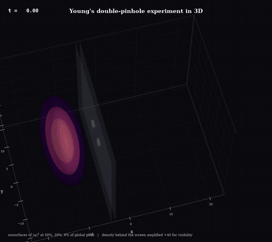
  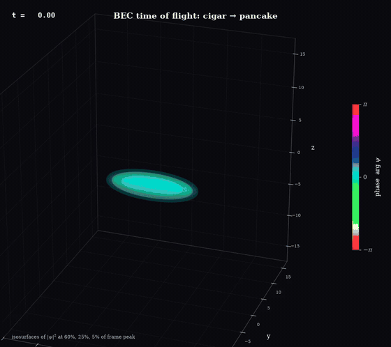
</p>
<p align="center"><em>Left: Young's double-pinhole experiment in 3D (|ψ|² isosurfaces). Right: a Bose–Einstein condensate released from a cigar-shaped trap, coloured by the quantum phase arg ψ.</em></p>

Every new feature is checked against exact or independent results; see [Validation](#validation).

---

## Key Features

- **Multi-Dimensional Unitary Solvers**: High-precision split-step solvers in **1D, 2D, and 3D** that conserve total probability norm to machine precision (< 10⁻¹²).
- **Physical Observables Module**: Real-time evaluation of expectation values (⟨x⟩, ⟨p⟩, ⟨E⟩, ⟨T⟩, ⟨V⟩) and quantum uncertainties (Δx, Δp) proving Heisenberg's uncertainty principle.
- **Modular Potential Registry**:
  - **Barriers**: Gaussian (1D/2D/3D), Rectangular, Step, Multiple, and Resonant Tunneling Diodes (RTD).
  - **Wells**: Infinite Square Well, Finite Square Well, and quartic Double Well.
  - **Oscillators**: Harmonic Oscillator.
  - **Periodic**: Sine-squared lattice (Crystal Potential).
  - **Disorder**: Cell-based random potential for Anderson localization.
  - **Custom**: User-defined Python callable functions.
- **Absorbing Boundary Layer (ABL)**: Prevents artificial reflections at domain edges in all dimensions.
- **Aesthetic Plotting**: Publication-ready scientific plotting with LaTeX markup, custom typography, light/dark themes, and dual-space (position and momentum side-by-side) analyses.
- **2D Visualization**: Probability density heatmaps, snapshot grids, and orthogonal slices for 3D wavefunctions.
- **3D Space-Time Rendering**: Premium 3D surface visualizations of 1D probability density evolution over time.

### New in v1.1

- **Generic split-operator engine** (`SplitOperatorSolver`, 1D/2D/3D): 2nd-order Strang and **4th-order Yoshida** splitting, measured convergence orders 2.00 and 4.00.
- **Time-dependent potentials** V(r, t): dipole driving with pulse envelopes (`DipoleDrive`, `sin2_envelope`) and user-defined `TimeDependentCustomPotential`.
- **Gross–Pitaevskii equation**: cubic nonlinearity g|ψ|²ψ for BEC dynamics and matter-wave solitons; GP energy and chemical potential.
- **Stationary states**:
  - imaginary-time ground and excited states, including nonlinear GP ground states, which converge with O(dτ²) accuracy;
  - direct eigensolvers built on a matrix-free FFT Hamiltonian: ARPACK Lanczos, or LOBPCG with a k-space preconditioner.
- **New potentials**: anisotropic `HarmonicTrap`, multi-slit / multi-pinhole `ApertureScreen` (2D/3D), chaotic `StadiumBilliard`.
- **New observables**: probability current **j**, ⟨L_z⟩, autocorrelation C(t) for Feit–Fleck spectra, full 3D support for all expectation values.
- **3D volumetric rendering** (`IsosurfaceRenderer`, `IsosurfaceAnimation`):
  - nested |ψ|² isosurfaces, coloured by the quantum phase arg ψ, with an orbiting camera, exported to MP4/GIF;
  - an interactive, rotatable HTML export (Plotly).
- **Validation suite** (`benchmarks/validation_suite.py`): every check is compared against analytic or independent references, and the measured errors are written to a report.

---

## Architecture

```
quantumlab/
├── core/
│   ├── grid.py              # Grid1D, Grid2D, Grid3D — discretized spatial domains
│   ├── wavefunction.py      # WaveFunction1D/2D/3D — state representation
│   ├── spectral.py          # Dimension-agnostic FFT helpers (k², dV, coordinates)
│   └── absorbing_boundary.py  # Absorbing Boundary Layer (ABL)
├── solvers/
│   ├── split_step_1d.py     # 1D Split-Step Fourier solver
│   ├── split_step_2d.py     # 2D Split-Step Fourier solver
│   ├── split_step_3d.py     # 3D Split-Step Fourier solver (CPU/SciPy)
│   ├── split_step_3d_gpu.py # 3D SSFM with CuPy GPU acceleration + CPU fallback
│   └── split_operator.py    # Generic 1D/2D/3D engine: order 2/4, V(r,t), GPE, imaginary time
├── stationary/
│   ├── eigensolver.py       # Lanczos / preconditioned LOBPCG on a matrix-free Hamiltonian
│   ├── imaginary_time.py    # Ground & excited states, GP ground states
│   └── hamiltonian.py       # Spectral application of H (incl. g|ψ|²)
├── potentials/
│   ├── base.py              # Abstract Potential base class
│   ├── barriers.py          # Gaussian (1D/2D/3D), Rectangular, Step, Multiple, RTD
│   ├── wells.py             # InfiniteSquareWell, FiniteSquareWell, DoubleWell
│   ├── oscillator.py        # HarmonicOscillator
│   ├── periodic.py          # CrystalPotential
│   ├── disorder.py          # RandomDisorder
│   ├── custom.py            # CustomPotential (user-defined callable, 1D/2D/3D)
│   ├── traps.py             # HarmonicTrap (anisotropic, 1D/2D/3D)
│   ├── apertures.py         # ApertureScreen (multi-slit/pinhole), StadiumBilliard
│   └── time_dependent.py    # DipoleDrive, TimeDependentCustomPotential, sin2_envelope
├── observables/
│   ├── expectation.py       # Position, momentum, energy expectation values & uncertainties
│   ├── coefficients.py      # Transmission & reflection coefficients
│   ├── momentum.py          # Momentum-space wavefunction
│   ├── current.py           # Probability current, ⟨L_z⟩, autocorrelation
│   └── nonlinear.py         # GP interaction energy, energy functional, chemical potential
├── visualization/
│   ├── plots_1d.py          # 1D wavefunction & dual-space plots
│   ├── plots_2d.py          # 2D density heatmaps, snapshots, orthogonal 3D slices
│   ├── plots_3d.py          # 3D space-time surface rendering
│   ├── animation.py         # Time-evolution animation exporter (MP4/GIF)
│   ├── volume_3d.py         # 3D isosurfaces with phase colouring, animations, HTML export
│   └── style.py             # Theme management (light/dark)
├── config.py                # Default config loader (YAML-based)
├── constants.py             # Physical constants (atomic units)
└── runner.py                # HPC batch simulation runner (YAML-driven)
```

---

## Example Gallery

The framework includes 10 pre-built simulation scripts under the `examples/` directory. Run any example to generate high-quality scientific visualizations saved to the `output/` directory.

---

### 1. Gaussian Barrier Scattering (`examples/01_gaussian_barrier.py`)

Propagates a 1D wave packet towards a Gaussian potential barrier, resolving reflection (*R*) and transmission (*T*) coefficients with R + T = 1.000000 conservation.

**Final State Plot:**


**3D Space-Time Surface:**


**Dual Space Analysis (Position & Momentum):**


---

### 2. Harmonic Oscillator (`examples/02_harmonic_oscillator.py`)

Simulates a coherent state wave packet oscillating back and forth in a parabolic well, demonstrating exact total energy conservation (fractional drift < 10⁻⁵).

**Final State Plot:**
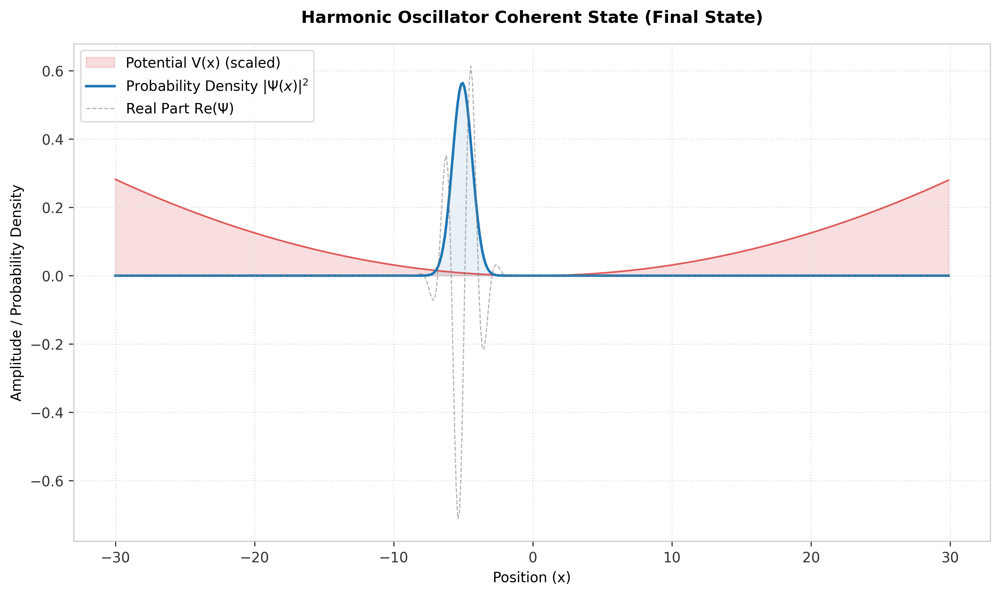

**3D Space-Time Surface:**


---

### 3. Double Well Tunneling (`examples/03_double_well.py`)

Illustrates quantum tunneling and wave packet oscillations between two symmetric quartic wells separated by a central potential barrier.

**Final State Plot:**
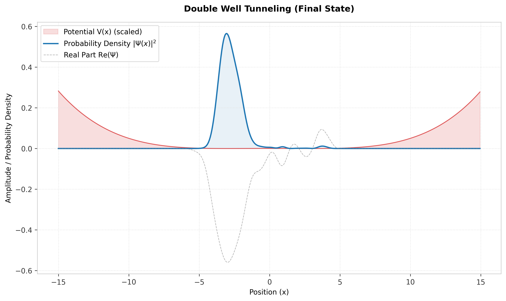

**3D Space-Time Surface:**


---

### 4. Multiple Barrier Scattering (`examples/04_multiple_barriers.py`)

Models wave packet splitting and high-frequency interference fringes as the packet scatters off multiple rectangular barriers.

**Final State Plot:**


**3D Space-Time Surface:**


**Dual Space Analysis:**


---

### 5. 2D Gaussian Barrier Scattering (`examples/05_2d_gaussian_barrier.py`)

A 2D Gaussian wave packet scatters off an isotropic radially-symmetric Gaussian barrier on a 256×256 grid. Demonstrates 2D quantum diffraction with a heatmap of final probability density and a 6-panel snapshot grid showing the full wave packet evolution.

**Final Probability Density (Light Theme):**
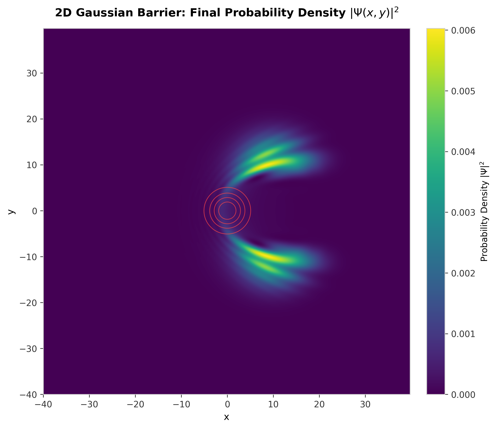

**Final Probability Density (Dark Theme):**
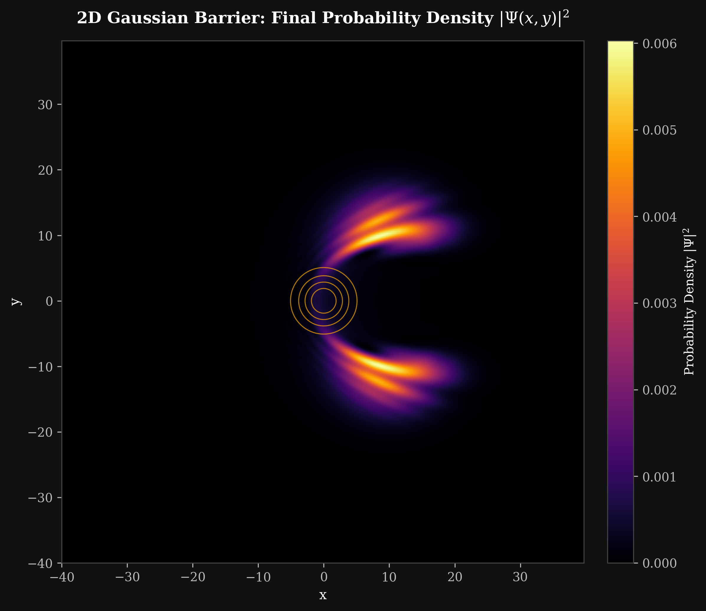

**Wave Packet Evolution Snapshots:**
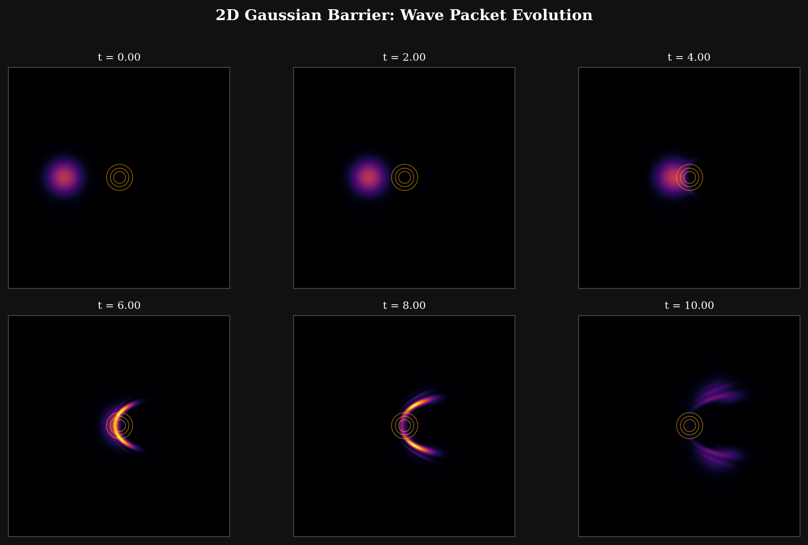

---

### 6. 3D Gaussian Barrier Scattering (`examples/06_3d_gaussian_barrier.py`)

A 3D Gaussian wave packet propagates through a spherical Gaussian barrier on a 64³ grid. Orthogonal slice plots (XY, XZ, YZ planes) visualize the 3D probability density at multiple timesteps.

**Orthogonal Slices at t = 2.00 (Step 100):**


**Orthogonal Slices at t = 4.00 (Step 200):**
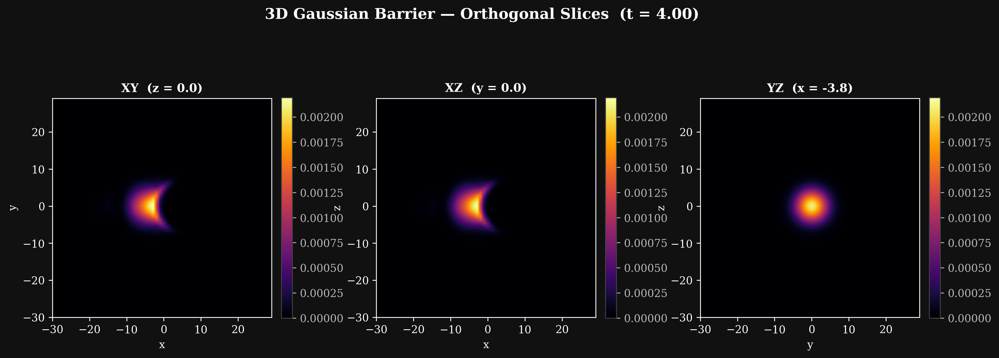

**Orthogonal Slices at t = 6.00 (Step 300):**
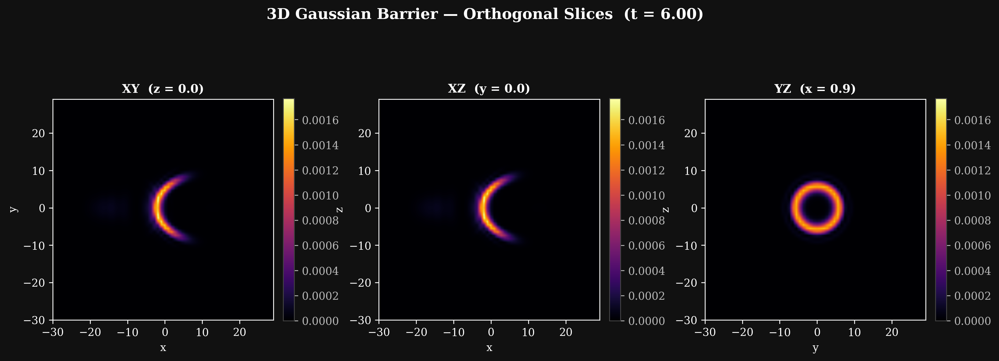

---

### 7. 3D Double-Pinhole Interference (`examples/07_3d_double_slit.py`)

Young's experiment in full 3D on a 128 × 96 × 96 grid (1.2 million points). A Gaussian packet (λ ≈ 2.1) hits an opaque screen with two circular pinholes (separation d = 5). Only about 2.4% of the probability is transmitted, so in the 3D view the density behind the screen is amplified ×40 for visibility; the caption on every frame says so.

**Validation:** the momentum distribution of the transmitted wave along y has zeros at k_y = ±(2n+1)π/d in the Fraunhofer model. The measured zeros are 0.638 and 1.890, against predictions of 0.628 and 1.885 (deviations +1.6% and +0.3%). The ideal model assumes two identical point sources, which finite pinholes in a Gaussian beam only approximate.

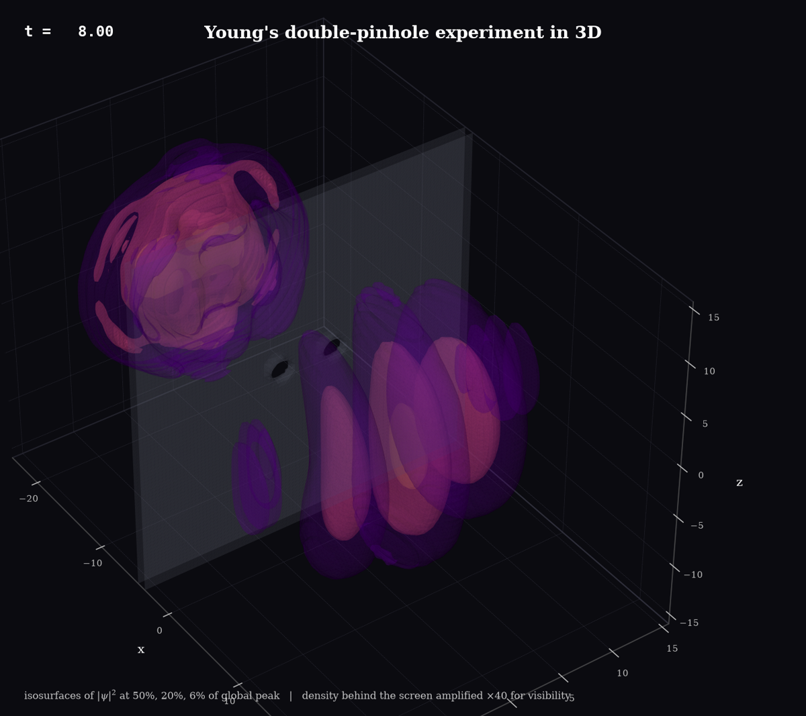

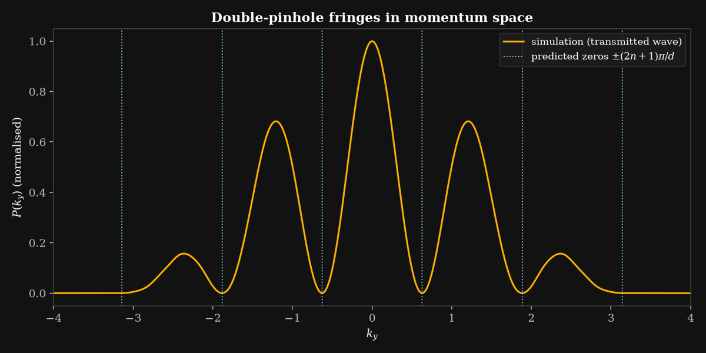

---

### 8. BEC Time of Flight (`examples/08_3d_bec_time_of_flight.py`)

A condensate is prepared in a cigar-shaped trap (ω = 0.7, 2.5, 2.5; g = 600) by imaginary-time relaxation of the Gross–Pitaevskii equation, starting from the Thomas–Fermi profile. The trap is then switched off. The tightly confined directions expand fastest, so the cloud turns from a cigar into a pancake: the **aspect-ratio inversion** that was one of the first signatures of Bose–Einstein condensation in 1995. The grid has 150 × 176 × 176 = 4.6 million points, wide enough that the expanded cloud stays clear of the periodic box faces (density there < 10⁻³ of the peak). Isosurfaces are coloured by the phase arg ψ; during the flight its gradient is the expansion velocity field.

**Validation:**
- The ground state satisfies the virial theorem 2⟨T⟩ − 2⟨V⟩ + 3E_int = 0 with a residual of 1.0 × 10⁻⁴.
- Norm is conserved to 12 digits through the flight.
- The rms widths follow the Castin–Dum scaling solution to within 0.58% along x and 0.23% along y and z.
- The inversion happens at t = 1.776, against the Castin–Dum prediction of 1.772. Castin–Dum is exact only in the Thomas–Fermi limit, and the kinetic energy here is about 5% of the total.

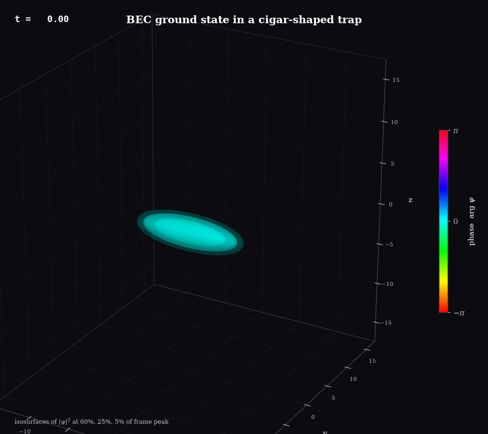

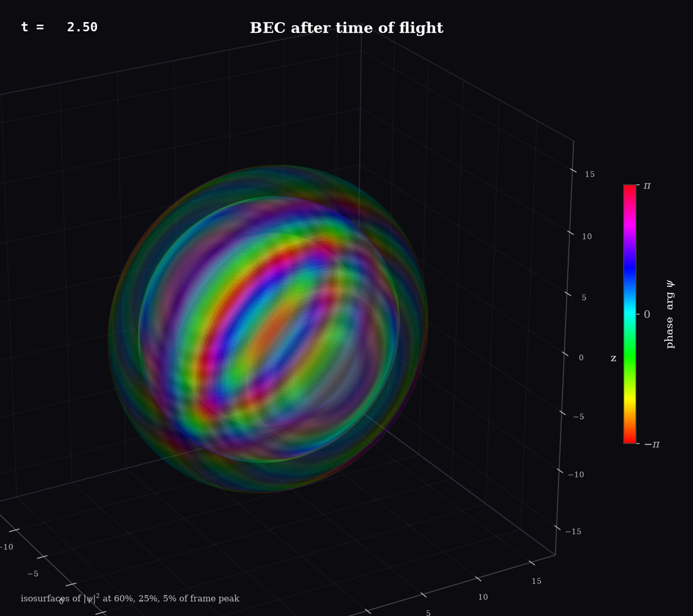

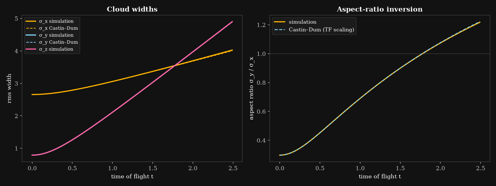

An interactive, rotatable version is written to `output/08_bec_tof_interactive.html`.

---

### 9. Bright Soliton Collisions (`examples/09_soliton_collision.py`)

Two exact sech solitons of the attractive 1D Gross–Pitaevskii equation (the focusing nonlinear Schrödinger equation) collide. The equation is integrable, so the solitons pass through each other or bounce off unchanged, depending on their relative phase. With the 4th-order solver, norm and GP energy are conserved to 10 digits, and the peak heights after the collision equal the initial κ² = 1 to within grid sampling (0.9999).

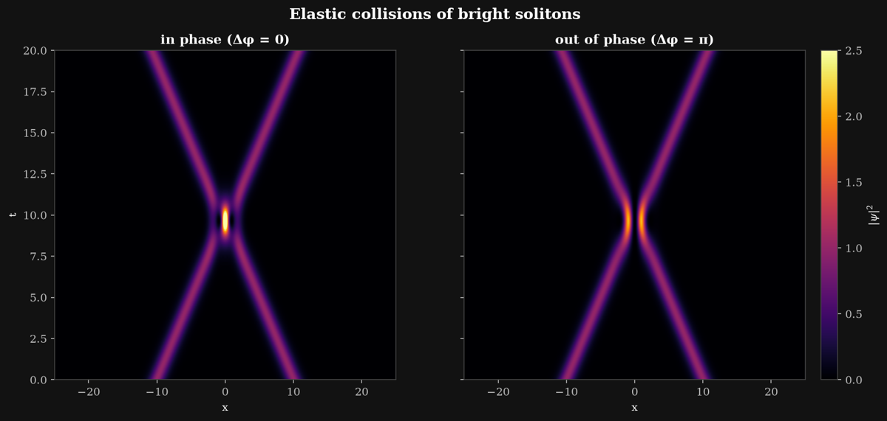

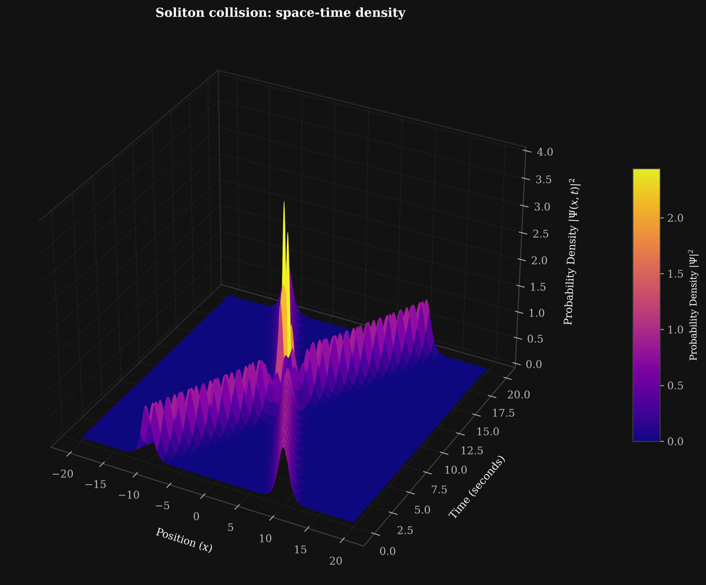

---

### 10. Quantum Chaos in the Stadium Billiard (`examples/10_quantum_chaos_stadium.py`)

The first 60 eigenstates of a soft-walled Bunimovich stadium, which is classically fully chaotic, computed with the k-space preconditioned LOBPCG solver. The low states are regular. Higher states show the irregular patterns typical of chaotic billiards, alongside "bouncing-ball" modes between the flat walls (e.g. n = 17 and n = 53).

**Validation:**
- The lowest levels from LOBPCG and from imaginary-time propagation agree to about 10⁻⁶.
- The level count N(E = 15.25) = 60 compares with 60.3 from Weyl's law, A·E/2π − P·√(2E)/4π. The walls are soft, so the boundary term is only approximate.

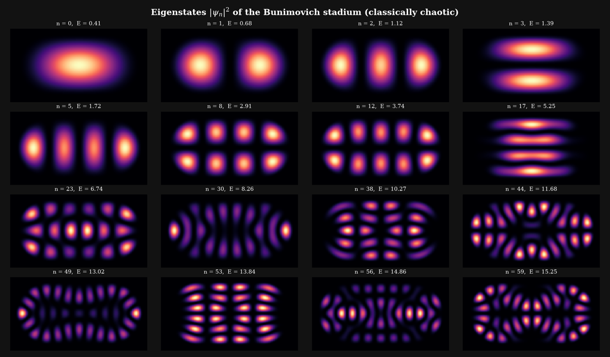

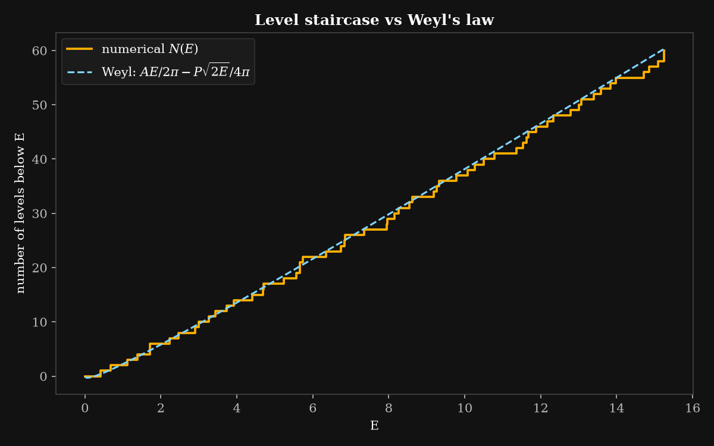

---

## Validation

`python benchmarks/validation_suite.py` runs a battery of checks against exact, analytic or independent numerical references and writes the measured errors to [`benchmarks/validation_report.md`](benchmarks/validation_report.md).

| Check | Reference | Measured error |
|---|---|---|
| Free Gaussian spreading (1D) | σ(t) = σ₀√(1+(t/2σ₀²)²), exact density | 1.37e-15 |
| Temporal convergence, Strang splitting | global error ∝ dt^2 | 9.10e-04 |
| Temporal convergence, Yoshida splitting | global error ∝ dt^4 | 3.47e-03 |
| Driven harmonic oscillator, t ≤ 20 | Ehrenfest: ⟨x⟩ = classical forced trajectory | 5.60e-09 |
| Norm conservation, 3D, 500 steps | unitary evolution: ‖ψ‖ = 1 | 2.55e-15 |
| Energy conservation, 3D, 500 steps (order 4) | E(t) = E(0) | 2.18e-10 |
| Minimum-uncertainty Gaussian (3D) | Δr_j Δp_j = ℏ/2 for each axis | 4.60e-12 |
| Angular momentum of a vortex state | ⟨L_z⟩ = ℏ for ψ ∝ (x+iy)e^{−r²/2} | 2.22e-16 |
| Harmonic spectrum 1D, 10 levels (Lanczos) | E_n = n + ½ | 4.80e-14 |
| Anisotropic 3D harmonic spectrum, 6 levels (LOBPCG) | E = Σ ω_j (n_j + ½) | 1.42e-13 |
| 3D ground state by imaginary time | E₀ = ½(ω_x+ω_y+ω_z) | 6.95e-10 |
| Spectrum from autocorrelation (Feit–Fleck) | peaks of FFT[C(t)] at n + ½ | 1.62e-03 |
| Moving bright soliton, t = 20 | exact sech solution of the 1D NLS | 1.46e-09 |
| Virial theorem, 3D GP ground state | 2⟨T⟩ − 2⟨V⟩ + 3E_int = 0 | 2.32e-06 |
| Imaginary-time GP ground state accuracy | residual ∝ dτ² (ratio 4 when halving dτ) | 2.23e-03 |

All 15 checks pass. A few rows report something other than a plain error:
- The two convergence rows give the deviation of the observed order (2.001 and 3.997) from the theoretical one.
- The Feit–Fleck row is limited by the spectral resolution 2π/T ≈ 0.031.
- The last row gives the relative deviation of the observed residual ratio (3.99) from 4.

---

## Installation & Usage

### 1. Install Dependencies

Install QuantumLab in development/editable mode (requires Python ≥ 3.9):

```bash
pip install -e .
```

**Core dependencies** (installed automatically):
- `numpy >= 1.22`
- `scipy >= 1.8`
- `matplotlib >= 3.5`
- `pyyaml >= 6.0`

**Optional extras** for full features (animation, GPU, interactive):

```bash
# 3D isosurface rendering (scikit-image) and interactive HTML export (Plotly)
pip install -e ".[viz3d]"

# Everything optional except GPU
pip install -e ".[full]"

# GPU acceleration via CuPy (requires CUDA)
pip install -e ".[gpu]"
```

MP4 export uses the `ffmpeg` executable (e.g. `brew install ffmpeg` or `apt install ffmpeg`). GIF export needs only Pillow.

### 2. Run Simulations

Run any example script from the project root:

```bash
# 1D simulations
python examples/01_gaussian_barrier.py
python examples/02_harmonic_oscillator.py
python examples/03_double_well.py
python examples/04_multiple_barriers.py

# 2D simulation (256×256 grid)
python examples/05_2d_gaussian_barrier.py

# 3D simulation (64³ grid)
python examples/06_3d_gaussian_barrier.py

# New in v1.1 (3D examples take a few minutes on a laptop)
python examples/07_3d_double_slit.py
python examples/08_3d_bec_time_of_flight.py
python examples/09_soliton_collision.py
python examples/10_quantum_chaos_stadium.py

# Validation report
python benchmarks/validation_suite.py
```

All outputs are saved to the `output/` directory.

### 3. Run Verification Tests

Execute the full unit test suite to verify physical accuracy and energy conservation:

```bash
pytest tests/ -v
```

Test coverage includes:
- `test_solvers.py` — 1D SSFM norm conservation
- `test_2d_solver.py` — 2D SSFM norm conservation
- `test_3d_solver.py` — 3D SSFM norm conservation
- `test_observables.py` — Expectation value correctness
- `test_potentials.py` — Potential evaluation correctness
- `test_3d_observables.py` — 3D expectation values, Heisenberg bound, T + R, Parseval
- `test_runner.py` — YAML runner in 1D/2D/3D, GPU fallback, split-operator option
- `test_split_operator.py` — agreement with legacy solvers, convergence orders 2 and 4, driven oscillator, free spreading
- `test_stationary.py` — harmonic spectra in 1D/2D/3D, Lanczos vs LOBPCG, imaginary-time accuracy
- `test_gross_pitaevskii.py` — bright soliton, GP energy conservation, virial theorem in 1D/2D/3D
- `test_new_potentials_and_observables.py` — traps, apertures, stadium, current, ⟨L_z⟩, Feit–Fleck spectrum
- `test_volume_3d.py` — isosurface geometry, phase sampling, PNG/GIF/HTML export

---

## Quick Start

```python
import numpy as np
from quantumlab.core.grid import Grid1D
from quantumlab.core.wavefunction import WaveFunction1D
from quantumlab.potentials import GaussianBarrier
from quantumlab.solvers import SplitStep1DSolver
from quantumlab.observables import transmission_coefficient, reflection_coefficient

# Setup
grid      = Grid1D(N=1024, x_min=-50.0, x_max=50.0)
wf        = WaveFunction1D.gaussian(grid, x0=-20.0, k0=3.5, sigma=4.0)
potential = GaussianBarrier(V0=6.0, width=1.5, position=2.0)
solver    = SplitStep1DSolver(grid, potential, dt=0.04)

# Evolve
for _ in range(800):
    wf = solver.step(wf)

# Analyze
R = reflection_coefficient(wf, barrier_position=2.0)
T = transmission_coefficient(wf, barrier_position=2.0)
print(f"R={R:.4f}, T={T:.4f}, R+T={R+T:.6f}")
```

### Advanced: GPE ground state, 4th-order dynamics and 3D rendering

```python
import numpy as np
from quantumlab.core.grid import Grid3D
from quantumlab.potentials import HarmonicTrap
from quantumlab.stationary import ground_state, eigenstates
from quantumlab.solvers.split_operator import SplitOperatorSolver
from quantumlab.visualization.volume_3d import IsosurfaceRenderer

grid = Grid3D(64, -8, 8, 64, -8, 8, 64, -8, 8)
trap = HarmonicTrap((1.0, 1.0, 2.0))

# Linear spectrum (exact: E = Σ ω_j (n_j + ½))
energies, states = eigenstates(grid, trap, n_states=4)

# Gross–Pitaevskii ground state by imaginary time (ψ normalised to 1, g includes N)
wf, info = ground_state(grid, trap, dtau=0.005, nonlinearity=200.0)
print(info.chemical_potential, info.residual)

# Imprint a vortex and evolve with the 4th-order solver
wf.psi *= np.exp(1j * np.arctan2(grid.Y, grid.X))
solver = SplitOperatorSolver(grid, trap, dt=0.005, order=4, nonlinearity=200.0)
wf = solver.evolve(wf, 200)

IsosurfaceRenderer(grid, levels=(0.5, 0.15, 0.03)).save(wf.psi, "vortex.png", t=solver.t)
```
